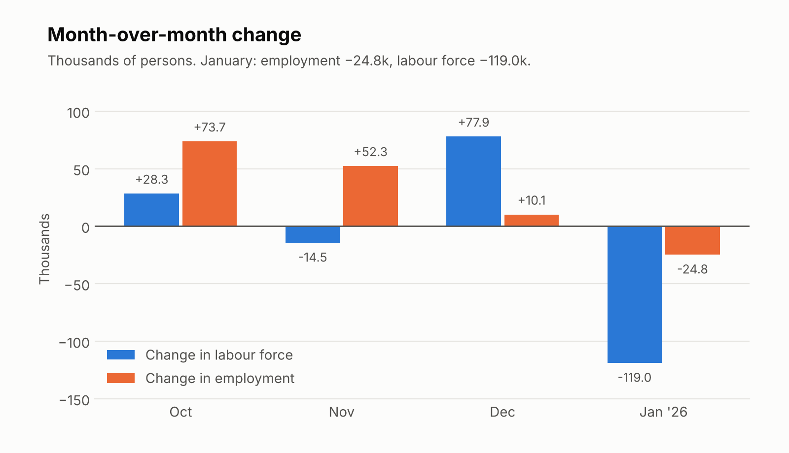
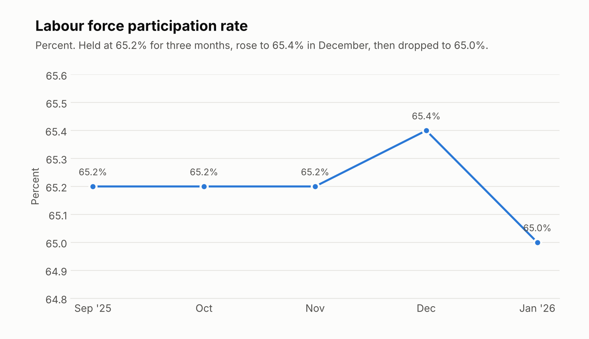
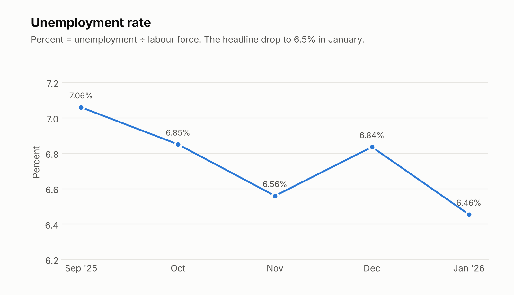

# Canadian Labour Market Analysis: January 2026

**ECON 351 – Assignment 2** · University of Waterloo

Statistics Canada's January 2026 Labour Force Survey showed the unemployment rate **falling from 6.8% to 6.5%**. Headlines treated that as good news, but employment actually **fell by about 25,000** the same month. This project works out how both can be true, using five months of Labour Force Survey data (September 2025 – January 2026).

📄 **Full written analysis:** [`ECON_351_Assignment_2_corrected.pdf`](ECON_351_Assignment_2_corrected.pdf) (4 pages)

---

## The question

Does a falling unemployment rate mean the labour market is getting stronger?

Not necessarily. The unemployment rate is a ratio:

```
Unemployment rate = Unemployed / Labour force
```

and a ratio can fall for two very different reasons:

1. **More people find work.** Employment rises and unemployment falls. This is a healthy decline.
2. **Fewer people participate in the labour force.** People stop searching, are reclassified as "not in the labour force", and stop being counted as unemployed. Nobody got a job, but the rate still drops.

The analysis tests which of the two happened in January.

## Data

Monthly Labour Force Survey figures, in thousands of persons (seasonally adjusted), plus the participation rate. Unemployment is derived as labour force minus employment, and the rate as unemployment divided by labour force.

| Month | Labour force | Employment | Unemployment | Unemployment rate | Participation rate |
|---|---:|---:|---:|---:|---:|
| Sep 2025 | 22,606.0 | 21,009.9 | 1,596.1 | 7.06% | 65.2% |
| Oct 2025 | 22,634.3 | 21,083.6 | 1,550.7 | 6.85% | 65.2% |
| Nov 2025 | 22,619.8 | 21,135.9 | 1,483.9 | 6.56% | 65.2% |
| Dec 2025 | 22,697.7 | 21,146.0 | 1,551.7 | 6.84% | 65.4% |
| Jan 2026 | 22,578.7 | 21,121.2 | 1,457.5 | 6.46% | 65.0% |

Raw data: [`labour_force_data.csv`](labour_force_data.csv). Original Excel workbook with pivot tables and charts: [`ECON_351_Assignment_2.xlsx`](ECON_351_Assignment_2.xlsx).

## Method

1. Collected monthly employment, labour force and participation figures for the five months from the Statistics Canada Jobs Report.
2. Built pivot tables in Excel to organise the series and charted the levels.
3. Calculated month-over-month changes in employment and labour force with Excel formulas.
4. Derived unemployment as `labour force − employment`, and the unemployment rate as `unemployment ÷ labour force`.
5. Used the identity `Δ unemployment = Δ labour force − Δ employment` to separate how much of each monthly move came from hiring and how much from people entering or leaving the labour force.
6. Checked participation, since it moves the opposite way when people leave the labour force instead of finding work.

## Findings

### 1. January was the first month employment fell, and the labour force fell far more



| Month | Δ Labour force (k) | Δ Employment (k) | Δ Unemployment (k) | What drove it |
|---|---:|---:|---:|---|
| Oct 2025 | +28.3 | +73.7 | −45.4 | Hiring outpaced labour force growth |
| Nov 2025 | −14.5 | +52.3 | −66.8 | Job gains plus some people leaving the labour force |
| Dec 2025 | +77.9 | +10.1 | +67.8 | People entered the labour force faster than jobs were added |
| Jan 2026 | **−119.0** | **−24.8** | **−94.2** | Labour force exits; employment fell |

Employment rose in each of the three months to December. In January it fell by 24.8k, and the labour force fell by 119.0k, almost five times as much.

### 2. The whole January drop in unemployment is explained by the shrinking labour force

```
Δ unemployment = Δ labour force − Δ employment
−94.2k         = −119.0k        − (−24.8k)
```

Unemployment fell by 94.2k (1,551.7k to 1,457.5k). Employment did not rise, so none of that fall came from net job gains. It came from the labour force shrinking.

### 3. Participation fell too



Participation was flat at 65.2% for three months, rose to 65.4% in December, then dropped to 65.0% in January. If the unemployment rate had fallen because job opportunities improved, participation would normally hold steady or rise. Instead it fell. Unlike December, when employment and participation both expanded, January saw both decline.

### 4. The headline rate improved anyway



The rate fell from 6.84% to 6.46% (reported as 6.8% and 6.5%), a drop of about 0.4 percentage points. October and November also saw falls, but those came with employment rising. January is the only month where the rate fell while employment fell too.

## Conclusion

January's decline in the unemployment rate is largely a statistical by-product of a shrinking labour force, not evidence of a healthier job market. A genuine recovery needs rising employment and stable or rising participation, and January delivered neither.

## Limitations

- **Five months only.** One month of exits could be noise, so the data can't establish a trend.
- **Cause of the exit isn't identified.** People may have left because of discouragement, short-term volatility, or other reasons. The data are seasonally adjusted, so ordinary seasonal patterns are already removed. These figures can't separate the remaining explanations.
- **Survey estimates.** Labour Force Survey numbers carry sampling error, and small monthly changes should be read with caution.

## Skills demonstrated

- Labour market and macroeconomic analysis (labour force, employment, participation, unemployment rate mechanics)
- Excel: pivot tables, formulas for month-over-month changes, charts
- Data visualisation (Excel charts; a Python/matplotlib script is included to regenerate the README charts)
- Written economic analysis for a general audience

## Repository contents

```
.
├── README.md
├── ECON_351_Assignment_2_corrected.pdf  # full written analysis
├── ECON_351_Assignment_2.xlsx           # original workbook (pivot tables + charts)
├── labour_force_data.csv                # Sep 2025 – Jan 2026 series
├── make_charts.py                       # regenerates the charts above from the CSV
├── 02_monthly_changes.png
├── 03_participation_rate.png
└── 04_unemployment_rate.png
```

To regenerate the charts: `pip install matplotlib`, then `python make_charts.py`.
